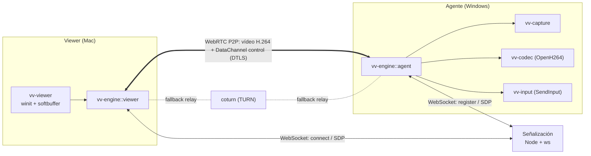
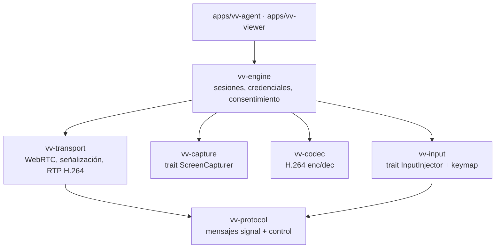
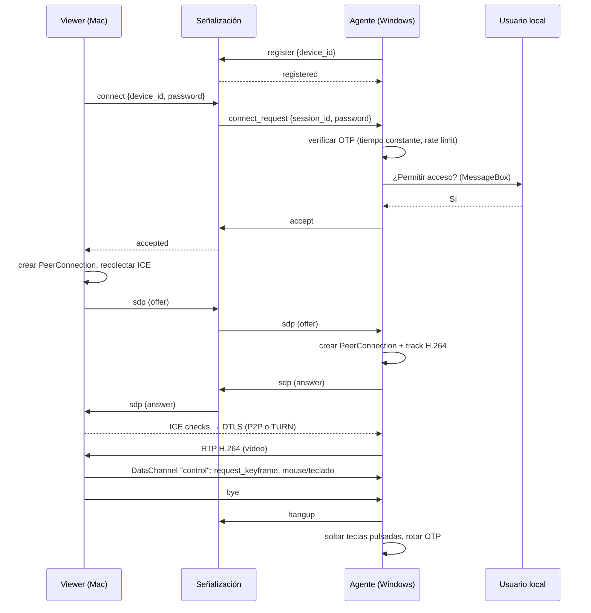

# Arquitectura de VersaViewer

Estado: **Fase 0 implementada** (prueba de viabilidad Windows ← Mac). Las
secciones marcadas *(objetivo)* describen la arquitectura final del blueprint.

## 1. Vista general

Principios aplicados (blueprint §2):

1. **Motor separado de la UI**: `vv-engine` no depende de ninguna librería
   gráfica; la UI recibe eventos por callback y envía input por un canal.
2. **Núcleo reutilizable**: todo en crates Rust; Flutter lo consumirá vía FFI.
3. **Adaptadores nativos** detrás de traits: `ScreenCapturer`, `InputInjector`.
4. **P2P primero, TURN como fallback**, y **el vídeo nunca pasa por el backend**.

## 2. Componentes (crates)

| Crate | Responsabilidad | Fase 0 | Siguiente paso |
|---|---|---|---|
| `vv-protocol` | Mensajes JSON de señalización y de control (versión 1) | ✅ | Versionado/negociación de capacidades |
| `vv-capture` | Captura de pantalla por cambios | DXGI Desktop Duplication (Windows), `xcap` (resto / respaldo) | Dirty rects, cursor, multi-monitor |
| `vv-codec` | Conversión I420 multihilo con reducción por área + H.264 Annex-B | OpenH264 SW, máx. 1920×1200 | Media Foundation/NVENC/QSV, VideoToolbox |
| `vv-input` | Inyección de input con teclas físicas (W3C `code`) | SendInput (Win), enigo (otros) | Multi-monitor, SAS vía servicio |
| `vv-transport` | WebRTC (webrtc-rs 0.21), reensamblado RTP, cliente WS | ✅ | Trickle ICE, jitter buffer, BWE → bitrate |
| `vv-engine` | Orquestación agente/viewer, OTP, rate limit, consentimiento | ✅ | Reconexión, FFI para Flutter |
| `services/signaling` | Presencia + broker de sesiones + relay SDP | Node `ws` | NestJS + Redis + JWT + auditoría |

## 3. Secuencia de conexión (Fase 0)

Correspondencia con el flujo del blueprint §5: los pasos 1–2 (autenticación de
usuario y permisos) y 6 (credenciales temporales emitidas por backend) se
sustituyen en la Fase 0 por el OTP generado por el agente; llegan en la Fase 2.

## 4. Protocolo

- **Señalización** (`crates/vv-protocol/src/signal.rs`, espejo en
  `services/signaling/src/protocol.ts`): JSON con etiqueta `type` en snake_case.
- **Control** (DataChannel `control`, fiable y ordenado,
  `crates/vv-protocol/src/control.rs`):
  - Coordenadas **normalizadas** `[0,1]` → independientes de resolución y DPI.
  - Teclas por **posición física** (W3C `KeyboardEvent.code`); la distribución
    del teclado remoto decide el carácter.
  - `request_keyframe` cuando el viewer detecta pérdida de paquetes.
- **Vídeo**: H.264 Constrained Baseline (`42e01f`, packetization-mode 1) sobre
  RTP; el viewer reensambla por marker bit y descarta hasta el próximo IDR al
  detectar huecos de secuencia.

## 5. Modelo de hilos

| Hilo | Agente | Viewer |
|---|---|---|
| Tokio (red) | señalización, PeerConnection, envío RTP | señalización, PeerConnection |
| `vv-capture` | captura + codificación (backpressure, nunca descarta frames codificados) | — |
| `vv-input` | inyección (los handles del SO están ligados a su hilo) | — |
| `vv-decoder` | — | decodificación H.264 |
| Principal | — | bucle de eventos winit (obligatorio en macOS) |

## 6. Seguridad (Fase 0)

| Control del blueprint §6 | Estado |
|---|---|
| Cifrado del contenido | ✅ DTLS-SRTP / DTLS-SCTP (WebRTC) |
| Credenciales temporales | ✅ OTP de 8 caracteres (CSPRNG), rota tras cada sesión |
| Protección contra fuerza bruta | ✅ Agente: bloqueo exponencial tras 5 fallos. Servidor: límite de intentos por IP |
| Consentimiento explícito | ✅ Diálogo nativo, siempre encima (Windows) |
| Indicador visible de sesión | ✅ Título de consola + banner (Fase 1: icono de bandeja + borde) |
| Validación de mensajes | ✅ Esquema estricto en el servidor; solo los miembros de una sesión pueden enviarle SDP |
| Liberación de input al terminar | ✅ `release_all` al cerrar la sesión o perder el foco |
| Autenticación mutua de dispositivos | ⏳ Fase 2: par de claves por dispositivo |
| RBAC, auditoría, MFA, OIDC | ⏳ Fase 2 / Fase 11 |
| Señalización TLS | ⏳ Fase 2 (`wss://`) — hoy solo para LAN de pruebas |
| Actualizaciones firmadas | ⏳ Fase 12 |

No se implementa: ejecución oculta, persistencia encubierta ni evasión de
permisos del SO (blueprint §6).

## 7. Hoja de ruta

| Fase | Contenido |
|---|---|
| **0** ✅ | Prueba de viabilidad: agente Windows, viewer Mac, P2P/TURN, control |
| 1 | Rendimiento: DXGI + encoder HW, trickle ICE, jitter buffer, adaptación de bitrate por BWE, métricas de latencia, icono de bandeja |
| 2 | Backend NestJS (auth OIDC, dispositivos, sesiones, TURN REST credentials), `wss://`, agente como servicio de Windows (UAC, Ctrl+Alt+Supr) |
| 3 | Portapapeles, multi-monitor, reconexión automática |
| 4+ | Transferencia de archivos, agentes macOS/Linux, móviles, gestión empresarial (orden del blueprint §8) |
